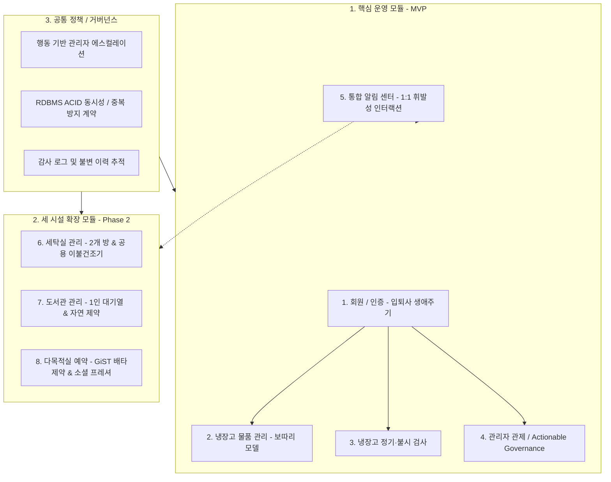

# 📋 DormMate 전체 기능 체계도 (System Functional Architecture)

*관련 핵심 계약서: [domain-context.md](domain-context.md) (현실 도메인 분석서) | [facility-contracts.md](facility-contracts.md) (시설 계약서) | [architecture-decisions.md](architecture-decisions.md) (아키텍처 결정서)*

---

DormMate는 280인 규모 기숙사 공동생활의 마찰을 줄이고 한정된 자원을 공정하게 분배하기 위해 **현재 핵심 서비스(냉장고 MVP)**와 **차기 확장 모듈(세탁실·도서관·다목적실)**로 구성되어 있습니다.

---

## 1. 핵심 운영 모듈 (MVP)

### 🔑 1) 회원 / 인증 시스템 (Auth) - 입사·퇴사 생애주기 관리
* **호실 기반 사전 발급 및 입사 배정**:
  * 오픈마켓형 가입 승인제 병목을 없애기 위해 `호실(201~524) + 개인번호(1~3)` 기반 슬롯을 사전 발급 ([ADR-001](architecture-decisions.md#adr-001-일반-회원가입-승인제-대신-호실-기반-사전-발급-슬롯-방식-채택)).
  * **입사 처리 (`POST /admin/resident-slots/{id}/check-in`)**: 관리자가 거주자 정보(이름 필수, 이메일 선택)와 처리 사유를 입력하여 계정을 활성화하고 초기 비밀번호(`0000`)를 발급.
* **최초 로그인 및 비밀번호 변경 강제 (`0000` 보호)**:
  * 초기 비밀번호(`0000`)로 로그인 성공 시 `mustChangePassword: true` 임시 세션 발급.
  * **비밀번호 변경 전까지 시설 이용·개인정보 조회 전면 차단 (HTTP 403 `PASSWORD_CHANGE_REQUIRED`)**.
  * `POST /auth/password`로 본인만의 비밀번호를 설정해야 일반 정식 이용 가능.
* **비밀번호 분실 시 관리자 초기화**:
  * 관리자가 본인 확인 후 초기화(`POST /admin/resident-slots/{id}/reset-password`) 실행.
  * 초기 비밀번호(`0000`)로 재설정 및 **기존 발급된 세션/토큰 전체 즉시 폐기**.
* **퇴사 처리 및 계정 데이터 완전 격리**:
  * **퇴사 처리 (`POST /admin/resident-slots/{id}/check-out`)**: 계정 비활성화(`INACTIVE`, `retired_at` 기록), 세션 전체 즉시 폐기, 호실 배정 종료(`released_at`).
  * **💡 핵심 데이터 격리**: 다음 학기 새 입주자에게 같은 `205-1` 표시 아이디를 배정하더라도, **내부적으로는 완전히 새로운 User UUID를 발급**.
  * 이전 거주자의 내역은 이전 UUID에 유지되며 새 입주자의 개인 내역으로 승계하지 않는다. 공용 시설 조회 범위는 해당 시설의 권한 정책을 따른다.
* 상세 API·운영 절차: [계정 생애주기 계약](account-lifecycle.md). 초기화·퇴사 요청에는 현재 `userId`와 처리 사유가 필요하며, 비밀번호 변경 후에는 다시 로그인한다.
* **사용자 열거 공격 방어 및 보안 표준**:
  * 로그인 실패 시 아이디 부존재와 비밀번호 불일치 모두 동일하게 `401 INVALID_CREDENTIALS` 반환.
  * 계정 활성 상태 검사보다 비밀번호 일치 검사를 먼저 수행하여 비활성/퇴사 계정 스캐닝 원천 방어 ([ADR-007](architecture-decisions.md#adr-007-rfc-7807-표준-예외-응답-규격화-및-사용자-열거-공격user-enumeration-방어)).

---

### 🧊 2) 냉장고 물품 관리 (Inventory / Fridge)
* **호실-칸 정수 분배 접근 제어**:
  * 각 층 24개 호실을 3개 냉장 칸에 8개 호실씩 균등 분배, 냉동 1칸은 24개 호실 공용 ([domain-context.md Section 2-2](domain-context.md#2-2-24개-호실-균등-배분-수학적-규칙)).
  * 일반 거주자 로그인 시 배정된 칸(`accessibleCompartmentIds`)만 암묵적으로 제한(Implicit Scope)하여 조회/등록 허용 ([ADR-010](architecture-decisions.md#adr-010-공용-엔드포인트에서의-역할별-암묵적-권한-스코프implicit-scope와-파라미터-무력화)).
* **보따리(Bundle) 및 품목(Item) 등록 (장바구니형 원자적 생성)**:
  * 물리적 용기(지퍼백, 락앤락)를 1개의 보따리로 추상화.
  * 보따리 1개당 3자리 고유 라벨 번호(`001`~`999`, DB에는 `INT` 저장, UI에서 3자리 포맷팅) 자동 발급 ([ADR-008](architecture-decisions.md#adr-008-도메인-식별자uuid와-사용자-인지용-라벨int의-엄격한-분리)).
  * 최소 1개 이상의 유효 품목이 포함되어야만 등록 허용 (빈 보따리 생성 방지, Fail-Fast) ([ADR-013](architecture-decisions.md#adr-013-냉장고-보따리bundle-생성-시-빈-보따리-임시-저장-허용-배제-fail-fast-원칙)).
  * 칸별 허용량(`max_bundle_count`) 초과 시 `422 CAPACITY_EXCEEDED` 반환.
* **수기 표기의 한계 극복과 규칙 진화(Rule Evolution) 수용성**:
  * 종이 스티커 수기 표기의 한계로 인해 생긴 복잡한 규정(락앤락 2개, 지퍼백 2개 제한 등)을 DB 스키마에 하드코딩하지 않고, **유연한 보따리 모델로 추상화하여 향후 행정 규칙 진화에 영구 대응** ([ADR-016](architecture-decisions.md#adr-016-수기-표기의-한계-극복과-보따리bundle-모델을-통한-규정-진화rule-evolution-수용성-확보)).
* **라벨 재사용 및 조회/검색**:
  * 보따리 삭제 시 소프트 삭제 처리 후 재사용 풀(`recycled_numbers`)로 회수하여 우선 재발급.
  * 탭 필터: `전체`, `내 물품`, `임박(D-3 이하/노란 배지)`, `만료(D-0/빨간 배지)`.
  * 프라이버시 보호: 보따리 메모는 **작성자 본인에게만 노출** (타인 및 층별장 열람 시 마스킹).
  * 스티커 검색: “칸 선택 + 3자리 번호” 또는 품목/포장명 키워드 교차 검색
---

### 🔍 3) 냉장고 정기·불시 검사 (Inspection)
* **점검 주기 (월 2회)**:
  * **정기 점검 (월 1회)**: 층별장 주관 정기 검사 (매월 지정일, 3일 전 밴드 공지).
  * **불시 점검 (월 1회)**: 층별장 또는 관리자(사감실) 주관 불시 위생 점검.
* **검사 세션 및 동시성 잠금 (Optimistic/Pessimistic Hybrid)**:
  * 층별장/관리자가 담당 층 칸을 대상으로 세션 시작 (`POST /fridge/inspections`).
  * 해당 칸이 **잠금 상태(`lockedUntil`: 30분 TTL)**로 전환되어 입주자의 수정/삭제 원천 차단 (`423 COMPARTMENT_LOCKED`).
  * 점검 활동 시 30분 자동 연장, 장시간 비활동 시 자동 해제.
* **조치 기록 (Action) 및 세부 위반 사유 (Reasons)**:
  * 백엔드 시스템은 **5가지 조치 액션(Action Type)**으로 결과를 기록하고 벌점을 연동합니다:
    - **통과 (`PASS`)**: 이상 없음 (벌점 0점).
    - **경고 (`WARN_INFO_MISMATCH`, `WARN_STORAGE_POOR`)**: 보관 상태 불량, 라벨/정보 불일치 (벌점 0점, 1:1 주의 안내).
    - **폐기 (`DISPOSE_EXPIRED`)**: 유통기한 경과 등 소유자가 특정된 위반 식품 폐기 (**해당 학생에게 건당 벌점 3점 부과** 및 1:1 결과 알림).
    - **미등록 물품 폐기 (`UNREGISTERED_DISPOSE`)**: 스티커 없는 무단 방치 물품 즉시 수거 및 폐기 (**당사자 미식별로 벌점 미부과**, 점검 회차별 폐기 운영 통계로만 집계).
  * **7대 현장 위반 사유 매핑**: 점검 시 선택/기록되는 구체적인 위반 사유(Reason)는 공문의 7대 기준(스티커 미부착, 유통기한 경과, 밀폐 불량, 배달용기 보관, 상태 불량/부패, 허용 규격 외 용기, 미신고 비식품)과 1:1로 매핑됩니다.
* **1:1 비공개 텍스트 요약 알림 (네이버 밴드 공개 박제 방지)**:
  * 검사 결과는 네이버 밴드에 공개 박제하지 않고, **해당 학생에게만 텍스트 요약 알림(예: `"경고 1건, 폐기 1건이 발생했습니다."`)을 1:1 비공개 인앱 알림으로 발송**하여 감정적 마찰과 불쾌감을 차단합니다 (사진 전송 없음, 시스템 텍스트 요약 발송).

---

### 🛡️ 4) 관리자 관제 및 행동 기반 에스컬레이션 (Admin & Governance)
* **관리자 최상단 [조치 필요] 관제 카드 (`GET /admin/dashboard/action-required`)**:
  * 무차별 푸시 알림 대신, 관리자 웹 대시보드 최상단에 행정 개입이 필요한 이상 징후를 즉시 시각화:
    - **7일 이상 장기 연체된 도서** (학생 호실 `205호`, 학생명, 도서명 노출로 즉각적인 오프라인 회수/면담 지원)
  * *(세탁물 방치 및 스터디룸 취소는 임의의 강제 기준 없이 이용 이력 및 통계(Metrics/Audit Log)로만 가볍게 기록)*
* **관리자 일일 브리핑 (`GET /admin/digest/today`)**:
  * 매일 아침 09:00 배치 시 전일 발생한 장기 연체 등 조치 요망 항목 요약 리포트를 관리자에게 1회 종합 브리핑.
* **행정 강제 조치 API**:
  * `POST /admin/library/loans/{id}/force-return`: 장기 미반납 도서 관리자 권한 강제 회수.
  * `POST /admin/laundry/devices/{id}/force-release`: 비정상 방치 기기 관리자 권한 강제 해제.
* **역할 및 자원 관리**:
  * 일반 거주자 ➔ 층별장 승격/해제 즉시 반영 (`/admin/users/{id}/roles/floor-manager`).
  * 층별 칸 증설/축소에 따른 **호실 재배분 시뮬레이션 및 적용**.
  * 비정상 권한 불일치 물품(`vw_fridge_bundle_owner_mismatch`) 모니터링 및 강제 조치.
* **보안 및 접근 제어**:
  * `/admin/**` 모든 엔드포인트는 `ADMIN` 역할 필수 (`401 UNAUTHORIZED`, `403 FORBIDDEN`).
  * 초기 관리자 1회성 안전 부트스트랩 (`InitialAdminService`).

---

### 🔔 5) 통합 알림 유틸리티 (Notification) - 알림 피로도 최소화
* **1:1 개인화된 휘발성 인터랙션 집중**:
  * 네이버 밴드의 전체 공지와 중복 개발하지 않고, 학생 개인에게 꼭 필요한 1:1 알림에만 집중.
  * **유통기한 D-3 임박 알림**: 매일 아침 09:00 배치 시 1일 1회 요약 전송.
  * **세탁 종료 5분 전 리마인더**: 타이머 설정 불필요, 종료 5분 전 수거 준비 알림.
  * **세탁물 수거 30자 메모 알림**: 바구니 이동 후 발신자 호실 정보와 함께 전달.
  * **스터디룸 예약 시작 10분 전 리마인더**: 노쇼 방지 알림.
* **알림 피로 방지 및 중복 제거 (Anti-Spam)**:
  * 중복 방지 키(`dedupe_key`)를 통한 동일 이벤트 다중 발송 100% 차단.
  * TTL(기본 24시간 후 자동 만료) 적용으로 데이터베이스 비대화 방지.
  * 사용자별 알림 유형 ON/OFF 토글 지원.
* **알림 센터 UI**: 미읽음 상단 정렬, 개별/전체 읽음 처리, 하단 네비게이션 탭 배지(`9+`).

---

## 2. 세 시설 확장 모듈 (Phase 2 - ver1 배포 스펙)
*상세 계약서: [facility-contracts.md](facility-contracts.md) / 의사결정 기록: [architecture-decisions.md](architecture-decisions.md)*

### 🧺 6) 세탁실 관리 (Laundry)
* **단일 세탁실 내 2개 방 구조 (총 23대)**:
  * **남성 세탁실 방**: 세탁기 6대 + 일반 건조기 2대 + **대형 이불 건조기 2대 (남녀 공용)**
  * **여성 세탁실 방**: 세탁기 7대 + 일반 건조기 6대
  * **💡 공용 동선 규칙**: 기숙사 내 유일한 대형 침구 건조기 2대는 공간 배치상 남성 세탁실 방 안쪽에만 위치하므로, **여학생도 이불 건조기를 이용하기 위해 남성 세탁실 방으로 출입하여 예약·가동할 수 있도록 `facility_zone = 'COMMON'`으로 개방** ([domain-context.md Section 3-1](domain-context.md#3-1-세탁실-내부-공간-배치-spatial-layout)).
* **사용 등록 및 진행 관리**:
  * 사용 가능(`AVAILABLE`) 기기 선택 후 가동 시작 ➔ `IN_USE` 전환.
  * 1인 동시 최대 2대 선점 제한 (원자적 조건부 갱신으로 동시성 보장).
  * **기종별 최근 사용 시간 기억 (UX 디테일)**:
    - 세탁기/건조기/이불건조기 기종별로 직전에 설정했던 이용 시간을 백엔드 `laundry_usage_log` 최근 1건 조회를 통해 자동 완성 (기기 변경/캐시 삭제와 무관하게 100% 본인 설정 복원).
  * **종료 5분 전 자동 알림**: `expected_end_at - 5분` 시점에 수거 준비 인앱 알림 자동 발송.
* **세탁물 수거 알림 (핵심 배려 인터랙션)**:
  * 다음 사용자가 완료 세탁물을 바구니로 옮긴 후 전송하는 알림.
  * **최대 30자 메모 입력 가능** (예: `"3층 핑크색 바구니에 담아뒀어요"`, 미입력 시 표준 문구).
  * **발신자 호실('205호') 표기**: 장난 알림 방지 및 책임감 부여, 개인 프라이버시 보호(실명/개인번호 비노출) ([ADR-002](architecture-decisions.md#adr-002-세탁실-마찰-감소와-신상-노출-트레이드오프)).
* **운영 마찰 통계화**:
  * 완료 후 세탁물 미수거 이력은 기기 회전율 파악을 위한 이용 로그(Metrics Log)로 가볍게 기록.

---

### 📚 7) 도서관 관리 (Library)
* **도서 검색 및 대출/반납**:
  * 도서 카탈로그 검색 (도서명, 저자, 도서번호).
  * 기본 대출 14일 (1인 최대 3권), 1회 한정 연장(+7일, 대기자 없을 시).
* **경량 공정 대기열 (1인 제한)**:
  * 도서 1권당 **예약 대기열 최대 1명 제한** (`uq_library_active_reservation_per_book`).
  * 반납 시 예약자에게 5일간 우선 대출 보장 (타인 대출 시 `403 RESERVED_FOR_ANOTHER`).
* **도메인 자연 제약 (Local Natural Rule) & 3단계 에스컬레이션**:
  * **신규 대출 차단**: 연체 도서를 1권이라도 보유한 학생은 **모든 도서의 신규 대출만 시스템적으로 차단 (`403 OVERDUE_RESTRICTION`)**.
  * **세탁실·스터디룸·냉장고 정상 이용 보장**: 사감실과 미협의된 전역 시설 차단은 배제.
  * **점진적 에스컬레이션**:
    1. *연체 1~3일*: 학생 본인에게 매일 아침 09:00 인앱 리마인더 발송.
    2. *연체 7일 이상*: 관리자 대시보드 최상단 [조치 필요] 배지에 호실(`205호`)과 도서명 강조 노출.
    3. *매일 09:00*: Daily Admin Digest로 관리자에게 장기 연체 요약 전달 및 오프라인 회수/면담 연계.

---

### 🏢 8) 다목적실/스터디룸 예약 (Study Room)
* **시설 구성**: 3개 다목적실 (`ROOM_A`, `ROOM_B`, `ROOM_C`).
  * 별도의 방별 인원 제한(4인/6인/8인 등) 규칙은 기숙사에 존재하지 않으며, **예약 시 실제 이용할 인원 수(`attendeeCount`)만 기재**.
* **타임라인 예약 프로세스**:
  * 주간 타임라인(오늘 ~ 차주 일요일) 기준 **10분 단위** 예약 (최소 30분 ~ 최대 3시간).
* **💡 독점 방지: 투명한 달력 UI를 통한 소셜 프레셔 (사회적 억제)**:
  * 복잡한 주당 시간 쿼터나 노쇼 벌점 알고리즘 대신, **달력 UI를 넘겼을 때 과거/현재 예약자의 호실('205호')과 이용 시간이 투명하게 공개**되어 공동체 평판에 의해 자발적 독점 자제 유도 ([ADR-003](architecture-decisions.md#adr-003-스터디룸-자원-독점-방지의-도메인적-해법)).
* **동시성 및 중복 방지 계약 (PostgreSQL GiST 배타 제약)**:
  * 동일 룸 시간 겹침 원천 차단: `tstzrange` 기반 `EXCLUDE USING gist` (`409 TIME_SLOT_OVERLAPPED`) ([ADR-006](architecture-decisions.md#adr-006-외부-분산-락redis-배제와-postgresql-gist-배타-제약을-통한-무결성-확보)).
  * 1인 동시간 다중 룸 예약 원천 차단: 동일 사용자 시간 범위 배타 제약 (`409 USER_ALREADY_RESERVED_TIME`).
* **운영 마찰 통계화**:
  * 예약 취소 내역은 이용 이력 및 감사 로그로만 가볍게 기록.

---

## 3. 공통 거버넌스 및 시스템 정책

| 정책 영역 | 핵심 규칙 |
| :--- | :--- |
| **역할 권한 (RBAC)** | • `RESIDENT`: 본인 칸/물품 등록·관리, 시설 예약·대출, 본인 세션 관리 • `FLOOR_MANAGER`: 거주자 권한 + 담당 층 냉장고 칸 잠금 검사 및 조치 기록 • `ADMIN`: 전역 접근, 역할 임명/해제, 시설 강제조치, Action Required 관제, 감사 로그 |
| **벌점 집행 원칙** | • **유일한 벌점 부과 창구**: **냉장고 정기/불시 검사** (사생수칙 제28조) • **벌점 점수**: 위반(폐기) **건당 벌점 3점** 부과 • **타 시설 자동 벌점 배제**: 도서 연체, 세탁 방치, 스터디룸 취소는 자동 벌점 대신 통계(Metrics) 및 감사 로그로 경량화 |
| **시설 이용 제재 원칙** | • **미협의된 10점 전역 자동 차단 전면 배제**: 사감실과 공식 협의되지 않은 세탁/스터디 일괄 차단은 배제하여 민원 방지 • **도서관 자연 제약**: 연체 도서 보유 시 **도서 신규 대출만 차단 (`OVERDUE_RESTRICTION`)** (세탁·스터디룸·냉장고 정상 이용 보장) • **냉장고 등록 상시 보장**: 물리적 잠금장치가 아닌 위생 소프트웨어이므로 물품 등록 권한은 영구 보장 ([ADR-015](architecture-decisions.md#adr-015-냉장고-물품-기입-시스템의-본질과-행동-기반-관리자-에스컬레이션actionable-admin-governance)) |
| **관리자 에스컬레이션** | • 1단계: 학생 본인 1~3일 자동 리마인더 • 2단계: 관리자 대시보드 최상단 **[조치 필요] 배지 카드** (7일 이상 장기 연체 도서 호실 즉시 노출) • 3단계: 매일 09:00 **Daily Admin Digest** 요약 리포트로 오프라인 행정/면담 연계 |
| **동시성 및 중복 방지** | • **냉장고**: 칸별 라벨 시퀀스 락, 검사 세션 진행 중 타 사용자 수정 차단 (`423`) • **세탁실**: 동일 기기 동시 사용 차단 (`AVAILABLE` 조건부 원자적 갱신), 1인 동시 2대 초과 선점 차단 • **도서관**: 도서 1권 동시 대출 원자적 차단, 예약 대기열 1명 초과 등록 DB Unique 인덱스 차단 • **다목적실**: 동일 룸 시간대 중복 차단 (`tstzrange` Exclusion Constraint), 1인 동시간 다중 룸 예약 차단 |
| **감사 로그 (Audit Log)** | • 검사 제출/정정, 벌점 부과/취소, 시설 강제 예약/차단, 입·퇴사 슬롯 배정 등 모든 관리자 행위 영구 기록 (`audit_log`) |